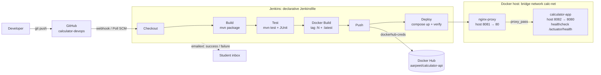

# CI/CD Pipeline for a Calculator REST API — Mini-Project Report

**Course:** CSE 816 Software Production Engineering (M.Tech CSE, Term I 2026-27) · **Faculty:** Prof. B. Thangaraju
**Student:** Aarpeet Chandrasekhar · Aarpeet.Chandrasekhar@iiitb.ac.in
**Repository:** https://github.com/Aarpeet/calculator-devops · **Image:** https://hub.docker.com/r/aarpeet/calculator-api

## 1. Overview

A Spring Boot 3 (Java 17, Maven) REST service exposes `add`, `subtract`, `multiply` and `divide` under
`/api/v1` plus `/actuator/health`. Inputs are bound to `BigDecimal` for exact results, and a
`@ControllerAdvice` maps missing, non-numeric or out-of-range parameters and division by zero to
**HTTP 400** with `{error, status, timestamp}`. **48 JUnit 5 tests** (unit + `@SpringBootTest`/MockMvc
integration) give 95.5 % line and 100 % branch coverage (JaCoCo). The pipeline turns every push to `main`
into a tested, versioned Docker image on Docker Hub and a health-verified Compose deployment, with no manual steps.

## 2. Pipeline & Deployment Architecture



```
 git push ─▶ GitHub ─(webhook | pollSCM H/5)─▶ Jenkins
   Checkout ─▶ Build ─▶ Test ─▶ Docker Build ─▶ Push ─────────▶ Docker Hub (:N, :latest)
   (scm)     (package) (JUnit)  (:N,:latest)   (creds store)
                                                   └─▶ Deploy: DOCKER_IMAGE=…:N docker compose up -d
                                                          │       └─ poll :8082/actuator/health + :8081/api/v1/add
   ┌───────────────── Docker host · network calc-net ─────▼──────────────────┐
   │ client ─▶ nginx-proxy (8081→80) ──▶ calculator-app (8082→8080, healthy) │
   └─────────────────────────────────────────────────────────────────────────┘
   post { success | failure } ─▶ email (job, build #, URL)
```

## 3. Jenkins Pipeline Stages

| Stage | What it does | Key design decision |
|---|---|---|
| **Checkout** | `checkout scm`: fetches the commit that triggered the run | Triggered by `githubPush()`; `pollSCM('H/5 * * * *')` is the fallback when GitHub cannot reach a localhost Jenkins |
| **Build** | `mvn clean package -DskipTests -B` | Fast compile/package feedback before the slower test run |
| **Test** | `mvn test -B`; `post { always { junit 'target/surefire-reports/*.xml' } }`, JaCoCo report archived | A failing test makes Maven exit non-zero, so the build fails; results are published even on failure |
| **Docker Build** | `docker build -t aarpeet/calculator-api:${BUILD_NUMBER} -t …:latest .` | Immutable build-number tag for traceability and rollback; `latest` for convenience |
| **Push** | `echo $PSW \| docker login --password-stdin`, push both tags, `docker logout` in `post { always }` | Credentials only from the Jenkins store (`dockerhub-creds`, an access token); single-quoted `sh` keeps the secret out of Groovy interpolation and the log |
| **Deploy** | `DOCKER_IMAGE=…:${BUILD_NUMBER} docker compose up -d --remove-orphans`, then up to 30 × 5 s polls of the app and proxy | The stage fails (dumping `compose ps` and logs) unless both `/actuator/health` = UP and `/api/v1/add?a=2&b=3` returns 5 |

Pipeline options: `disableConcurrentBuilds()`, `timestamps()`, 30-minute `timeout`, build discarder. The
`post` block emails **success/failure** to the student via `emailext` (falling back to `mail`), with job name,
build number, image tag, duration and build URL; the failure email attaches the log. A `cleanup` step keeps only
the three newest image tags on the host.

## 4. Dockerfile (multi-stage) and Docker Compose

**Dockerfile.**
- *Stage 1* (`maven:3.9-eclipse-temurin-17-alpine`) copies **only `pom.xml`** and runs
  `mvn dependency:go-offline`. That creates a dependency layer that is reused until the POM changes (verified:
  after a source edit only `COPY src` and `package` re-run). It then copies `src/` and runs `mvn clean package -DskipTests`.
- *Stage 2* (`eclipse-temurin:17-jre-alpine`, no JDK or Maven) installs `curl` for health checks and creates
  `appuser:appgroup`. It copies **only** `calculator-api.jar` → `/app/app.jar`, root-owned and read-only, so the
  process can't modify its own code. It then switches to `USER appuser`, declares `EXPOSE 8080` and a
  `HEALTHCHECK`, and uses exec-form `ENTRYPOINT ["java","-jar","/app/app.jar"]` so the JVM is PID 1 and gets
  `SIGTERM` for graceful shutdown.
- `-XX:MaxRAMPercentage=75` makes the JVM respect container memory limits. `.dockerignore` limits the build
  context to `pom.xml` + `src/`.

**docker-compose.yml.**
- Two services on a custom bridge network **`calc-net`**:
  - `calculator-app`: image `${DOCKER_IMAGE:-aarpeet/calculator-api:latest}` with `build: .` fallback,
    `SPRING_PROFILES_ACTIVE=prod`, `SERVER_PORT=8080`, `restart: unless-stopped`, health check on
    `/actuator/health` (10 s / 5 s / 5 retries / 20 s start period).
  - `nginx-proxy`: `nginx:stable-alpine`, read-only `nginx.conf` mount, host port 8081, its own `/nginx-health`
    check. It starts only after the app is `service_healthy`.
- A single `docker compose up -d` brings up the whole stack. The fixed project name `calculator-devops` makes
  local runs and Jenkins manage the *same* stack.

## 5. Challenges Faced and Solutions

| # | Challenge | Engineering solution |
|---|---|---|
| 1 | **Port clash**: Jenkins runs natively on host port 8080, so the API cannot publish `8080:8080`. | The container still listens on 8080 (EXPOSE, health check, Nginx upstream unchanged); only the host mapping is `${APP_HOST_PORT:-8082}:8080`, and Nginx is on 8081. |
| 2 | **Stale proxy after redeploy**: Nginx resolves `calculator-app` once at start-up. When a deploy recreates the app with a new IP, the proxy returns 502. | `resolver 127.0.0.11 valid=10s` + `proxy_pass` via a variable forces per-request DNS through Docker's embedded resolver. Verified by forcing the app IP to change (`.2 → .4`): the proxy kept serving with no restart. |
| 3 | **Idempotent, re-runnable deploys**: the Jenkins workspace and a developer checkout would create two Compose projects fighting over the same ports. | Fixed Compose `name:`, `disableConcurrentBuilds()`, immutable tags, `--remove-orphans`. Re-running a deploy with the same tag is a no-op; a new tag replaces only `calculator-app`. |
| 4 | **Clean numeric output**: `double` gives `0.1+0.2 = 0.30000000000000004` and `5.0`; `BigDecimal.stripTrailingZeros()` gives `1E+1`. | `BigDecimal` arithmetic, normalised to scale ≥ 0, and Jackson `WRITE_BIGDECIMAL_AS_PLAIN` (`0.0000001`, not `1E-7`). Byte-exact JSON is asserted in the integration tests. |
| 5 | **Resource-exhaustion input**: `a=1e999999999` parses as a valid `BigDecimal` but would expand to a billion digits when rendered. | Operand magnitude bounded to `[1e-100, 1e100]` (`IllegalArgumentException` → HTTP 400), with tests. |
| 6 | **Secrets in CI**: Groovy-interpolated credentials leak into process lists and logs. | `credentials()` binding, single-quoted `sh`, `--password-stdin`, `docker logout` in `post { always }`, an access token instead of the password, and `.gitignore` for `.env`/keys. |
| 7 | **Jenkins execution context**: steps run as the `jenkins` user under `/bin/sh` (dash), not bash. | `jenkins` added to the `docker` group; all `sh` blocks are POSIX and were tested under `/bin/sh -xe`, including the failure path (exit 1 with diagnostics). The Jenkinsfile was checked with Jenkins' declarative linter. |
| 8 | **Silent email failure**: build #1 logged only `Sending email to: …`, but no mail arrived. email-ext hides SMTP errors outside debug mode, and the institute mailbox (Microsoft 365) filters Gmail-relayed automation. | Enabled email-ext debug mode, which exposed Gmail's `535-5.7.8 Username and Password not accepted`. Fixed by storing a Gmail **App Password** (2-Step Verification) in the `gmail-smtp` credential, and sent notifications to a Gmail inbox. |

## 6. Live Demo Checklist (Class 17) and Screenshot Guide

**Before class:**
- `systemctl status jenkins` is running.
- The last build is green.
- `docker compose ps` shows both containers **(healthy)**.
- A test email has been received.
- The webhook tunnel is running (or rely on Poll SCM, ≤ 5 min).
- Terminal tabs are open for `git`, `docker ps` and `curl`.

**Live demo:**
1. **Repo tour:** README, `git log --graph --oneline --all` (progressive commits, two merged PRs), `.gitignore`, no secrets.
2. **Walk through** `Jenkinsfile` → `Dockerfile` → `docker-compose.yml` → `nginx/nginx.conf`, explaining each stage.
3. **Make a visible change** on a branch:
   - Change the message in `CalculatorService.divide` to `"Cannot divide by zero"`.
   - Update the expected string in both test classes.
   - Commit, open a PR and merge to `main` (or push directly).
4. **Show the trigger:** a new Jenkins build starts automatically. Narrate the stages in Stage View.
5. **Show the result:**
   - The Test stage publishes 48 passing tests.
   - Docker Hub shows the new tag `:N`.
   - `docker ps` shows `aarpeet/calculator-api:N` (healthy).
   - `curl :8081/api/v1/divide?a=1&b=0` returns the new message.
6. **Show the success email** in the inbox.
7. *(Optional)* Push a commit that breaks a test → red Test stage, no deploy, the running version keeps serving, and a failure email arrives. Then revert.

**Screenshot capture guide:**

| # | Screenshot | Where |
|---|---|---|
| 1 | Green pipeline (all 6 stages) | Jenkins job page → *Stage View* (`http://localhost:8080/job/calculator-devops/`) |
| 2 | JUnit results (48 tests, 0 failures) | Build → *Test Result* |
| 3 | Deploy verification log | Build → *Console Output* ("Deployment healthy …") |
| 4 | Email notification | Inbox: `[Jenkins] SUCCESS: calculator-devops #N` |
| 5 | Docker Hub tags `N` + `latest` | `hub.docker.com/r/aarpeet/calculator-api/tags` |
| 6 | Running containers | `docker ps` (both **healthy**, ports 8081/8082) |
| 7 | API responses incl. errors | `curl` on `:8082` and `:8081`: add/subtract/multiply/divide, `b=0` → 400, `a=abc` → 400 |
| 8 | Git practices | `git log --graph --oneline --all`; GitHub *Pull requests → Closed* (#1, #2 merged) |
